<picture>
  <source media="(prefers-reduced-motion: reduce)" srcset="assets/identity-static.svg">
  
</picture>

## Projects

- **[Prismestra](https://github.com/376east/prismestra)** — A Windows app that brings PC lights, LED strips, and LCDs into one scene.
- **[Burrow](https://github.com/376east/burrow)** — A desktop Minecraft launcher for custom modpacks and playing with friends.
- **[Kupleno](https://github.com/376east/kupleno)** — A local journal for purchases, returns, and receipts from Ozon, Wildberries, and Yandex Market.
- **[FaceFlow](https://github.com/376east/faceflow)** — A local event photo gallery where guests can find their pictures with a selfie.

[37.6 East](https://github.com/376east) · [Русская версия](README.ru.md)
