<picture>
  <source media="(prefers-reduced-motion: reduce)" srcset="assets/identity-ru-static.svg">
  
</picture>

## Проекты

- **[Prismestra](https://github.com/376east/prismestra)** — Подсветка ПК, ленты и LCD в одной сцене. Приложение для Windows.
- **[Burrow](https://github.com/376east/burrow)** — Лаунчер Minecraft для своих сборок и игры с друзьями.
- **[Куплено](https://github.com/376east/kupleno)** — Локальный журнал покупок, возвратов и чеков Ozon, Wildberries и Яндекс Маркета.
- **[FaceFlow](https://github.com/376east/faceflow)** — Фотогалерея, где участники съёмки находят свои кадры по селфи.

[37.6 East](https://github.com/376east) · [English](README.md)
